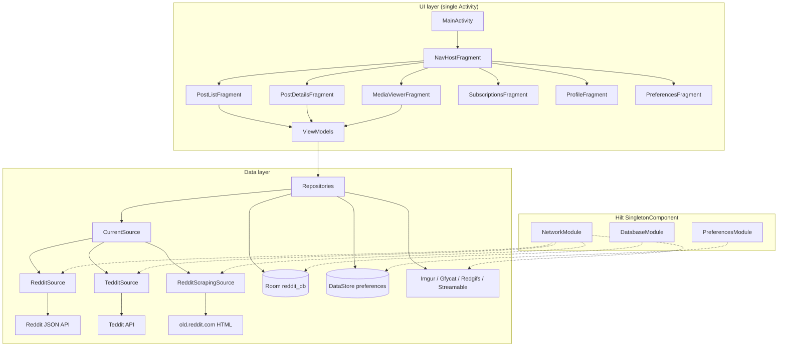

# 01 - Project Overview

This document describes the **Stealth for Reddit** (`unReddit`) application as it exists at the current HEAD (`07577e5`, after the `45fc13e` cookie-bootstrap hotfix and the later `3.0.0` updates). It replaces the previous architecture summary with a concrete, code-grounded runtime walkthrough.

All source paths below are relative to `app/src/main/java/com/cosmos/unreddit/` unless written in full. For the consolidated principles/evolution/fix narrative, see [08-Working-Principles-Evolution-and-Fixes.md](08-Working-Principles-Evolution-and-Fixes.md).

---

## What is Stealth?

**Stealth** is an account-free, privacy-oriented Reddit client for Android. It never asks for Reddit credentials and stores all user state locally.

- **Main goal:** browse Reddit anonymously, build per-profile subscription feeds, and render post media natively.
- **License:** **GPLv3**.
- **Namespace:** `com.cosmos.unreddit` (`buildSrc/src/main/kotlin/Config.kt:2`).
- **Application ID:** `com.rohitss.stealth` (`Config.kt:4`); debug builds append `.dev` → `com.rohitss.stealth.dev` (`app/build.gradle.kts:83`).
- **Version:** `3.0.0` (`versionCode 30`, `Config.kt:10-11`).
- **SDK:** `minSdk 23`, `compileSdk 33`, `targetSdk 33` (`Config.kt:6-8`).

> **"Account-free" is still true, but it is not the same as "no token".** Since 2026-10-22 the official JSON client acquires an anonymous, app-only Reddit OAuth token by spoofing Reddit's Android client. There is no user login and no user credentials; profiles and history stay local. See [App-only OAuth](#4-app-only-oauth-2026-10-22).

---

## Key Features

1. **Anonymity**
   - No login screen and no user account.
   - Anonymous, app-only Reddit OAuth token; no user credentials are stored or sent.
2. **Subscriptions & multi-profiles**
   - Subscriptions, history, saved posts and saved comments are scoped by `profile_id`.
   - Repository queries always take a `profileId`; there is no global user state.
3. **Content rendering**
   - Reddit gallery, image, GIF and video posts rendered in-app.
   - Third-party media resolved through Imgur, Gfycat, Redgifs and Streamable APIs.
   - ExoPlayer for video/audio, Coil for images/GIFs, `TouchImageView` for zoom.
4. **Offline persistence**
   - Room database `reddit_db` (schema v4) for subscriptions, history, profiles, saved posts/comments and redirect rules.
   - DataStore `preferences` for all settings and the active profile ID.
5. **UI customization**
   - Light / Dark / Amoled themes, left- and right-handed bottom navigation.
   - Privacy Enhancer: regex-based external-link redirects (per-service ON / OFF / ASK).

---

## High-Level Architecture

---

## Exact Runtime Flow

The table below is the end-to-end path from process start to a rendered feed. Each stage is expanded in the following subsections.

| # | Stage | Entry point | What actually happens |
|---|---|---|---|
| 1 | Process start | `UnredditApplication.onCreate()` | Reads theme from DataStore synchronously, sets night mode, installs crash handler |
| 2 | Activity | `MainActivity.onCreate()` | Applies theme, builds `NavHostFragment` + floating bottom nav, subscribes to `UiViewModel` |
| 3 | HTTP client | `NetworkModule.provideRedditOkHttpClient()` | Builds the OAuth and path-encoding interceptors used for every JSON call |
| 4 | OAuth gate | `RedditOAuthInterceptor.intercept()` | Mints the app-only token on first use, adds headers, refreshes once on `401` |
| 5 | Source choice | `CurrentSource` | Delegates to Reddit / Teddit / scraper based on `reddit_source` preference |
| 6 | Feed paging | `PostListViewModel` → `PostListRepository` → `SmartPostListDataSource` | Splits >100 subreddits into chunks, fetches in parallel, interlaces results |
| 7 | Mapping | `PostMapper2` → `PostUtil.filterPosts` | Converts `PostChild` to `PostEntity`, filters NSFW, marks seen/saved |
| 8 | Profile scope | `BaseViewModel.currentProfile` | Every DAO query is re-issued with the active `profileId` |
| 9 | Post detail | `PostDetailsViewModel` | Two listings (post + comments); "more comments" always goes to the official API |
| 10 | Media | `LinkHandler` → `MediaViewerViewModel` → `MediaViewerAdapter` | Classifies the URL, resolves third-party metadata, plays with ExoPlayer |
| 11 | Download | `MediaDownloadWorker` | Downloads video and audio separately and muxes them on API 29+ |
| 12 | Privacy | `LinkHandler.openLink()` → `LinkRedirector` | Rewrites external hosts according to `redirect` rows, or asks the user |

---

### 1. Process start

`UnredditApplication.onCreate()` (`UnredditApplication.kt:41`):

1. **Theme read (blocking).** `runBlocking { preferencesRepository.getNightMode().first() }` (`:45`) reads the `night_mode` key from DataStore `preferences`.
   - Default when unset is `AppCompatDelegate.MODE_NIGHT_FOLLOW_SYSTEM`.
   - The `appTheme` setter (`:29-39`) is invoked:
     - AMOLED (`mode == 434`) → forces `AppCompatDelegate.MODE_NIGHT_YES` **and** returns `R.style.AmoledAppTheme`.
     - Any other value → `AppCompatDelegate.setDefaultNightMode(mode)` and returns `R.style.AppTheme`.
2. **Crash handler.** `Thread.setDefaultUncaughtExceptionHandler(FileUncaughtExceptionHandler(this))` (`:49`).
   - Writes the stack trace to `getExternalFilesDir()/uncaught/<appName>_<versionName>_<date>.log`, then calls `exitProcess(0)` (`util/FileUncaughtExceptionHandler.kt:20-42`).
3. **Coil loader.** `newImageLoader()` (`:52-63`):
   - API >= 28 → `ImageDecoderDecoder.Factory()` (animated GIF/WebP via platform decoder).
   - API < 28 → `GifDecoder.Factory()`.
   - `crossfade(true)`.
4. **WorkManager.** `getWorkManagerConfiguration()` supplies the Hilt `HiltWorkerFactory` (`:65-71`). The `androidx.startup` initializer is removed in `AndroidManifest.xml` so WorkManager is initialized on demand with this factory.

### 2. Activity and navigation

`MainActivity.onCreate()` (`MainActivity.kt:51-92`):

1. `setTheme(unredditApplication.appTheme)` (`:55`) **before** `super.onCreate`.
2. Edge-to-edge via `WindowCompat.setDecorFitsSystemWindows(window, false)`.
3. `initNavigation()` (`:95`):
   - Finds the `NavHostFragment` in `R.id.fragment_container`.
   - Attaches `setupWithNavController(...)` to the bottom navigation.
   - Re-selecting `home` calls `PostListFragment.scrollToTop()`.
4. `UiViewModel` collectors run while `STARTED`:
   - `navigationVisibility` → `showNavigation()` (the first value is dropped so `initBottomNavigationView` controls initial visibility).
   - `leftHandedMode` → rebuilds the bottom nav with `Gravity.BOTTOM or Gravity.START` vs `Gravity.BOTTOM or Gravity.END` (`:133-135`), swaps rounded corners and sets `HideBottomViewBehavior(leftHandedMode)`.
   - `policyDisclaimerShown` → if false and `2023-06-10` has passed, waits 5 s (`:239-244`) and shows an indefinite Snackbar that opens `PolicyDisclaimerDialogFragment`.
5. `onDestinationChanged` (`:211`) shows the bottom nav only for `postListFragment`, `subscriptionsFragment`, `profileFragment`, `preferencesFragment`; every other destination hides it.

Navigation graphs live in `app/src/main/res/navigation/`: `navigation_graph.xml` (root), `home.xml`, `subscriptions.xml`, `profile.xml`, `settings.xml`, `post.xml`, `subreddit.xml`, `user.xml`, `viewer.xml`, `search.xml`, `backup.xml`. Safe Args generates the argument classes.

### 3. Network stack and exact URL construction

`NetworkModule` (`di/NetworkModule.kt`) provides four OkHttp clients. Application interceptors run **in the order added**:

| Qualifier | Interceptors (in order) | CookieJar | Retrofit target |
|---|---|---|---|
| `@RedditOkHttp` | `RawJsonInterceptor` → `JsonInterceptor` → `RedditPathInterceptor` → `RedditOAuthInterceptor` | none | `RedditApi` at `https://oauth.reddit.com/` (`@RedditOfficial`) |
| `@RedditScrapOkHttp` | none | `RedditCookieJar` | `RedditApi` at `https://old.reddit.com/` (`@RedditScrap`) |
| `@TedditOkHttp` | `RawJsonInterceptor` → `TargetRedditInterceptor` | none | `TedditApi` at user-configured instance |
| `@GenericOkHttp` | none | none | Imgur / Gfycat / Redgifs / Streamable |

All clients use 60 s connect/read/write timeouts (`:49`).

**Exact mutation of a Reddit JSON request:**

1. `RawJsonInterceptor` appends `raw_json=1` to the query (`data/remote/RawJsonInterceptor.kt:11-16`).
2. `JsonInterceptor` appends `.json` as a **path segment** (`data/remote/api/reddit/JsonInterceptor.kt:13-16`).
   - Example: `/r/android/hot?t=day` → `/r/android/hot/.json?t=day&raw_json=1`.
3. `RedditPathInterceptor` rewrites the blocked thread and more-children routes to their `%2f` forms (`RedditPathInterceptor.kt:24-41`).
4. `RedditOAuthInterceptor` adds `Authorization: Bearer ...`, the Android user agent and the spoofed client headers; on `401` it refreshes once (`RedditOAuthInterceptor.kt:12-47`).
5. Retrofit converts `Sort` / `TimeSorting` enums to their `type` strings through `SortingConverterFactory` (e.g. `TOP` → `top`, `BEST` → `confidence`).

The scraper client intentionally has **no** `.json`/`raw_json` interceptors: it fetches the old-Reddit HTML page and parses it with Jsoup.

The Teddit client's `TargetRedditInterceptor` adds `target=reddit` to every request (`data/remote/TargetRedditInterceptor.kt:13-16`); the Teddit endpoints themselves use the `?api` query suffix (`TedditApi.kt`).

### 4. App-only OAuth (2026-10-22)

`45fc13e` first tried to solve Reddit's browser challenge for `token_v2`; that path still received a server-side `403` on `.json`. The working fix imports Redlib's `MobileSpoof` technique:

| File | Role |
|---|---|
| `data/remote/api/reddit/RedditOAuthManager.kt` | Persists a device UUID; `POST https://www.reddit.com/auth/v2/oauth/access-token/loid` with Basic `ohXpoqrZYub1kg:` and Android client headers; caches token, `x-reddit-loid`, `x-reddit-session` and expiry in memory (`:30-137`) |
| `data/remote/api/reddit/RedditOAuthInterceptor.kt` | Adds `Authorization: Bearer ...` plus the spoofed headers; refreshes once on `401` (`:12-47`) |
| `data/remote/api/reddit/RedditPathInterceptor.kt` | Encodes `/r//comments` as `/r/%2fcomments` and `/api/morechildren` as `/api%2fmorechildren` (`:24-41`) |
| `data/remote/api/reddit/RedditApi.kt` | Official base URL is `https://oauth.reddit.com/` (`:113`) |
| `di/NetworkModule.kt` | `@RedditOkHttp`: `RawJson` → `Json` → `Path` → `OAuth`; no cookie jar (`:124-139`) |

The token lasts about 24 hours and is not persisted. Listings, `about`, user pages and search work directly; thread pages need the encoded slash because Reddit blocks the literal `/r//comments` path for app-only tokens. This is a private-client spoof, not an officially registered app, so it is ToS-sensitive and can break. Full evidence and caveats: [08 §3.1.2](08-Working-Principles-Evolution-and-Fixes.md#312-oauth-workaround--implemented-2026-10-22).

#### Historical: cookie bootstrap (`45fc13e`, removed 2026-10-22)

The following is retained as history; it is no longer wired.

**Files changed by `45fc13e`:**

| File | Change |
|---|---|
| `data/remote/api/reddit/RedditCookieInitializationInterceptor.kt` | **New** (96 lines): obtains the challenge cookie |
| `data/remote/api/reddit/RedditCookieJar.kt` | App-wide in-memory cookie cache merged with Android `CookieManager`; no longer only returns `over18=1` |
| `di/NetworkModule.kt` | Registers the interceptor and cookie jar on `@RedditOkHttp` |

**Exact sequence** (`RedditCookieInitializationInterceptor.kt`):

1. On **every** request through `@RedditOkHttp`, `hasRequiredCookies()` (`:12-14`) asks
   `RedditCookieJar.hasCookie("token_v2")`, which checks the in-memory cache and then
   `CookieManager`. It returns true only if the cookie is present.
2. If the cookie is missing, `initializeCookies()` (`:24-57`) runs **before** the original request:
   1. Build and execute a plain `GET https://www.reddit.com/` through the same chain (`:26-34`).
   2. Read the body as a string and close the response (`:33-34`).
   3. `Jsoup.parse(htmlBody)`; select `script[nonce]` and take its inner HTML (`:36-39`).
   4. Extract the challenge answer with the regex
      `await\(async\s+(\w+)=>(.+?)\)\("([^"]+)"\)` (`:59-73`).
   5. `executeOperation()` (`:78-90`) implements only one JS shape:
      - if the operation is exactly `param + param` (all `+` operands equal the parameter) → return `baseValue + baseValue`;
      - otherwise → return `baseValue`.
   6. Select `input[name=token]` or `input[name=jsc_token]`, keep the actual name, and read its `value` (`:40-42`).
   7. Execute `GET https://www.reddit.com/?solution=<solution>&js_challenge=1&<tokenName>=<tokenValue>&jsc_orig_r=` (`:43-50`) and close it.
   8. Log `Cookies Generated!` (`:52`).
3. Any exception is caught and logged as `CookieInterceptor` (`:54-56`); the original request still proceeds.
4. Cookies returned by either response are stored through OkHttp's cookie handling into `RedditCookieJar.saveFromResponse()`:
   - appended to an in-memory cache;
   - `CookieManager.setCookie(url, cookie.toString())` for each cookie, then `flush()` (`RedditCookieJar.kt:47-58`).
5. The original request continues with `chain.proceed(chain.request())` (`:21`). `loadForRequest()` merges the memory cache with the system cookies, so the request carries `token_v2` immediately plus `over18=1` (`RedditCookieJar.kt:21-45`).

**Important properties and limits:**

- The init requests are issued from the **last** application interceptor, so they are plain HTML requests and are **not** rewritten with `.json` or `raw_json=1`.
- The cookie gate is process-wide (`RedditCookieJar` is an `object`), so it normally runs once per install/session, not per request.
- The memory cache removes the old `CookieManager.setCookie()` asynchronous-read race; this is why earlier builds sometimes needed several launches before the `REDDIT` source worked.
- The JS extraction only supports the simple `await(async x => x + x)("...")` form. If Reddit changes the challenge shape, the solution string is wrong and the request proceeds without a valid token.
- `Cookie.parse()` failures in `loadForRequest()` are skipped instead of crashing (`RedditCookieJar.kt:34`).
- Since October 2026 Reddit also blocks anonymous `.json` at the server (`403` block page) even with a valid `token_v2`; `www.reddit.com/.../.rss` still works, but `old.reddit.com` redirects to login. See [04-Data-Layer.md § October 2026 update](04-Data-Layer.md#october-2026-update--anonymous-json-is-blocked).
- The jar is also attached to `@RedditScrapOkHttp`, so old-Reddit scraping shares the same system cookies, but the scraper client does **not** run the initialization interceptor.

### 5. Source selection

`DataPreferences.RedditSource` (`data/model/preferences/DataPreferences.kt:18-24`) maps the DataStore key `reddit_source` to:

| Value | Enum | Implementation |
|---|---|---|
| 0 (default) | `REDDIT` | `RedditSource` — Retrofit + Moshi over `www.reddit.com` JSON |
| 1 | `TEDDIT` | `TedditSource` — Retrofit over a Teddit instance |
| 2 | `REDDIT_SCRAP` | `RedditScrapingSource` — Jsoup over `old.reddit.com` HTML |

`CurrentSource` is a `@Singleton` wrapper (`data/remote/api/reddit/source/CurrentSource.kt`):

- The initial delegate is chosen in the constructor with `runBlocking { ... first() }` (`:27-30`).
- `setRedditSource(value)` swaps it under a `Mutex` (`:115-119`).
- Delegation is **not uniform**:
  - `getMoreChildren()` → always `redditSource` (`:59-62`).
  - `searchPost()` → always `redditSource` (`:86-94`).
  - `searchUser()` → always `redditSource` (`:96-104`).
  - Everything else → the active source.
- This routing exists because the alternative backends do not implement those endpoints:
  - `TedditSource.getMoreChildren/searchPost/searchUser` throw `UnsupportedOperationException` (`TedditSource.kt:43,74,83`).
  - `RedditScrapingSource.searchInSubreddit()` returns an empty `Listing` (`:58-60`); `getMoreChildren()` returns an empty `MoreChildren` (`:78-80`); `searchPost()` / `searchUser()` return empty listings (`:113-124`).

`TedditApi`'s base URL is read at provisioning time from `reddit_source_instance`; it is validated by `LinkValidator` and falls back to `https://teddit.net/` (`NetworkModule.kt:205-229`).

### 6. Feed request and paging

`PostListViewModel` (`ui/postlist/PostListViewModel.kt`):

1. `subreddit` and `sorting` combine into `Data.FetchMultiple` (`:68-78`).
2. `historyIds`, `savedPostIds` and `contentPreferences` combine into `Data.User` (`:80-88`).
3. `fetchData.flatMapLatest { userData.map { ... } }` then `flatMapLatest { getPosts(...) }` (`:96-101`).
4. `cachedIn(viewModelScope)` keeps the paging data across configuration changes.
5. `getPosts()` calls `repository.getPosts(query, sorting)` and applies `PostUtil.filterPosts(...)` (`:104-109`).

`PostListRepository.getPosts()` (`data/repository/PostListRepository.kt:53-83`) creates a Pager with `PagingConfig(pageSize = 25)` (`DEFAULT_LIMIT`, `:267`) and a `SmartPostListDataSource`.

`SmartPostListDataSource` (`data/remote/datasource/SmartPostListDataSource.kt`) is the concrete paging algorithm:

- Up to **100** subreddits (`REDDIT_SUBREDDIT_LIMIT`, `:127`): one request with names joined by `+` (`:101-111`).
- More than 100: split into chunks of
  `ceil(n / ceil(n / 100))` (`:34-36`); each chunk is joined with `+` and keeps its **own** `after` key (`:59-73`); requests run in parallel on a supervisor scope (`:75-86`).
- Merge policy (`:88-98`, `:114-123`):
  - `Sort.NEW` → flatten and sort by `PostChild.data.created` descending.
  - `Sort.TOP` → flatten and sort by score descending.
  - Everything else → interlace the chunk lists (`a,e,h,b,f,i,c,g`).
- The next page key is the list of each chunk's `after` value (`:96-98`).

`PostUtil.filterPosts()` (`util/PostUtil.kt:22-39`) maps every `PostChild` through `PostMapper2`, drops NSFW posts unless `show_nsfw`, and marks `seen`/`saved` from the profile's history and saved IDs.

### 7. Profiles, persistence and isolation

- Database: `room` database `reddit_db`, version 4, schema export enabled (`data/local/RedditDatabase.kt:22-32`; `di/DatabaseModule.kt:19-25`).
- Entities (`RedditDatabase.kt:22-30`):
  - `subscription`, `history`, `profile`, `post` (saved posts), `comment` (saved comments), `redirect`.
  - `SubredditEntity` exists as a mapping target but is **not** a Room entity (it is built by `SubredditMapper2` for the UI).
- First creation inserts profile `id = 1`, name `"Stealth"` (`RedditDatabase.kt:55-60`).
- Profile isolation:
  - Per-profile tables have `profile_id` in their primary key and a `FOREIGN KEY ... ON DELETE CASCADE`.
  - `MIGRATION_2_3` adds indexes on `profile_id` for history, post, subscription and comment.
  - DAO methods take `profileId`; the active profile comes from DataStore key `current_profile` (`model/preferences/ProfilePreferences.kt:9`).
  - `BaseViewModel.currentProfile` maps the stored ID to a `Profile` and every derived flow (`historyIds`, `subscriptions`, `savedPostIds`) re-flattens with `flatMapLatest` on profile change (`ui/base/BaseViewModel.kt:28-45`).
  - Selecting a profile calls `preferencesRepository.setCurrentProfile(profile.id)` (`PostListViewModel.kt:117`, `ProfileManagerViewModel.kt:41`).
- Saved items store a full snapshot (`PostEntity` / `Comment.CommentEntity`), not just an ID; history stores only `post_id` + `time`.

### 8. Post detail and comments

1. `PostListRepository.getPost(permalink, sorting)` emits `source.getPost(permalink, sort)` (`PostListRepository.kt:43-45`).
2. `RedditSource` parses the response as `List<Listing>` (`RedditSource.kt:69-73`).
3. `RedditScrapingSource` scrapes the same HTML twice, concurrently:
   `PostScraper` for the post and `CommentScraper` for the comments, then returns `listOf(post, comments)` (`RedditScrapingSource.kt:63-73`).
4. `PostUtil.getPostData(listings[0])` and `PostUtil.getCommentsData(listings[1])` (`util/PostUtil.kt`).
5. Expanding "load more comments" always calls the official `/api/morechildren?api_type=json` endpoint via `CurrentSource.getMoreChildren()` (`data/remote/api/reddit/RedditApi.kt:52-57`).

### 9. Media resolution and playback

**Classification.** `PostData.mediaType` (`data/remote/api/reddit/model/PostData.kt:128-181`) decides the type from API fields, not from the tapped URL:

| Condition | `MediaType` |
|---|---|
| `is_self` | `NO_MEDIA` (rendered as text) |
| `is_gallery` | `REDDIT_GALLERY` |
| `is_video` + `reddit_video_preview.is_gif` | `REDDIT_GIF` |
| `is_video` | `REDDIT_VIDEO` |
| `imgur.com` album/gallery `.gif`/`.mp4` | `IMGUR_ALBUM` / `IMGUR_GALLERY` / `IMGUR_GIF` / `IMGUR_VIDEO` / `IMGUR_LINK` |
| `i.imgur.com` | `IMGUR_GIF` / `IMGUR_VIDEO` / `IMGUR_IMAGE` |
| `gfycat.com` / `redgifs.com` / `streamable.com` | `GFYCAT` / `REDGIFS` / `STREAMABLE` |
| `v.redd.it` | `REDDIT_GIF` or `REDDIT_VIDEO` |
| Other media hints (`videoPreview`, `.gif`, `.gifv`, `.mp4`, `.webm`) | `VIDEO` |
| `i.redd.it` or image hint | `IMAGE` |
| Otherwise | `LINK` |

`PostData.mediaUrl` (`:183-204`) prefers the crosspost's URL, then `reddit_video_preview.fallback_url`, then the video preview fallback, then the first preview image.

**Tap handling.** `LinkHandler.handleLink()` (`util/LinkHandler.kt:29-65`):

- `/r/<name>` → `openSubreddit`; `/u/<name>` → `openUser`; `/r/...` permalink → `openRedditLink`.
- Media types → `openMedia()` → `MediaViewerFragment`.
- Everything else → `openLink()` → Privacy Enhancer decision → Custom Tab.

**Resolution.** `MediaViewerViewModel.retrieveMedia()` (`ui/mediaviewer/MediaViewerViewModel.kt:85-...`):

| `MediaType` | Resolved `GalleryMedia` |
|---|---|
| `IMAGE`, `IMGUR_IMAGE` | `IMAGE` with the URL |
| `IMGUR_LINK` | `IMAGE` at `https://i.imgur.com/<pathSegment0>` |
| `IMGUR_GIF` | `VIDEO` with `gif` → `mp4` replacement |
| `IMGUR_ALBUM`, `IMGUR_GALLERY` | `imgurRepository.getAlbum(<path segment 1>)`; each image is `VIDEO` if `preferVideo`, else `IMAGE`; an empty album falls back to `https://i.imgur.com/<albumId>` |
| `REDDIT_GIF`, `IMGUR_VIDEO`, `VIDEO` | `VIDEO` with the URL |
| `REDDIT_VIDEO` | `VIDEO` with `sound = LinkUtil.getRedditSoundTrack(url)` (`:100-103`) |
| `GFYCAT` | API call → mp4 URL from `content_urls` |
| `REDGIFS` | API call → `gif.urls.hd` |
| `STREAMABLE` | API call → `video.files.mp4.url` |
| `REDDIT_GALLERY` | Re-fetches the post by permalink (`getPost(permalink, BEST)`), maps it to a `PostEntity`, and uses its `gallery`; that list is `gallery_data.items` matched by ID against `media_metadata.items` (`PostData.kt:234-242`) |

**Rendering.** `MediaViewerAdapter` (`ui/mediaviewer/MediaViewerAdapter.kt`):

- Images: Coil with `Scale.FILL`, `Precision.AUTOMATIC`, memory/disk cache `READ_ONLY`, crossfade, retry button on error.
- Video: `ExoPlayerHelper` provides a `DefaultHttpDataSource` with the desktop Firefox user agent, cross-protocol redirects, and a **100 MB** `SimpleCache` in `cacheDir` (`util/ExoPlayerHelper.kt`).
- Redgifs URLs forward every query parameter as an HTTP request property (`MediaViewerAdapter.kt:188-193`), because Redgifs requires its signature parameters.
- The player repeats (`REPEAT_MODE_ALL`), autoplays, and exposes a mute toggle driven by whether an audio track is present (`:260-291`).

### 10. v.reddit audio

Two later commits changed this area:

- `bcfe7c2` — CMAF support: `REDDIT_VIDEO_REGEX` now matches `(DASH|CMAF)_(\d+)` (`util/LinkUtil.kt:16`).
- `dfa795f` — downloaded videos keep their audio.

**Playback path:**

1. `LinkUtil.getRedditSoundTrack(link)` (`util/LinkUtil.kt:57-63`) finds the `DASH_<n>` or `CMAF_<n>` segment and replaces it with `<format>_AUDIO_128` (`REDDIT_SOUNDTRACK_NAME`, `:27`). DASH and CMAF are preserved.
2. `MediaViewerAdapter` builds `MergingMediaSource(videoSource, audioSource)` when `GalleryMedia.sound != null` (`:205`).
3. If the audio request fails with HTTP 403 or 404 **and** the failing URL contains `_AUDIO_128`, it retries with the video-only item (`:248-258`). `isRedditSoundTrack()` checks the marker (`LinkUtil.kt:66-68`).
4. The mute button is shown only if an audio track exists (`:273-291`).

**Download path** (`data/worker/MediaDownloadWorker.kt`):

1. The video is saved as `<name>_video.<ext>` and the audio as `<name>_audio` (`:88`, `:101`).
2. On API >= 29, `muxAudioVideo()` (`:408-495`) creates a pending `video/mp4` MediaStore entry, copies the first `video/*` track and the first `audio/*` track into a `MediaMuxer` with `MUXER_OUTPUT_MPEG_4`, clears `IS_PENDING`, and deletes the two temporary entries.
3. On API < 29 there is no muxer path: `muxAudioVideo()` is skipped, `mergedUri` is `null`, so the worker reports failure even though the two files were written. This is a current limitation, not intended behavior.
4. Work is enqueued as unique work keyed by the URL with `APPEND_OR_REPLACE` and tag `MediaDownloadWorker` (`:390-404`); the notification channel is `<applicationId>.DOWNLOAD_MANAGER_CHANNEL`, notification ID `856`.

### 11. Downloads and notifications

- Permission model:
  - API <= 28: `WRITE_EXTERNAL_STORAGE` (`maxSdkVersion=28`) and `MediaScannerConnection` for legacy public directories.
  - API >= 29: MediaStore with `IS_PENDING=1` while writing, `IS_PENDING=0` on completion.
  - API >= 33: `POST_NOTIFICATIONS` is requested, but the download proceeds regardless of the result (`MediaViewerFragment` request launcher).
- Notification actions are `PendingIntent`s to `DownloadManagerReceiver` (`data/receiver/DownloadManagerReceiver.kt`):
  - `ACTION_DOWNLOAD_RETRY` re-enqueues the worker with the original URL/type/sound.
  - `ACTION_DOWNLOAD_CANCEL` calls `MediaDownloadWorker.cancelWork(context)` (cancels all work by tag).
- The receiver is not exported and is registered for `<applicationId>.ACTION_DOWNLOAD_RETRY` / `.ACTION_DOWNLOAD_CANCEL` in `AndroidManifest.xml`.

### 12. Privacy Enhancer

- Stored state: DataStore key `privacy_enhancer` (`DataPreferences.kt:15`).
- Redirect rules: Room table `redirect` with `pattern` (regex), `redirect` (target host), `service`, and `mode` (`ON=0`, `OFF=1`, `ALWAYS_ASK=2`) (`data/model/db/Redirect.kt`).
- `LinkRedirector` is a `@Singleton` that loads the enabled flag and all redirects in `runBlocking` at construction, compiles each `pattern` to a `Regex`, and keeps a `Map<Regex, Redirect>` (`util/LinkRedirector.kt:26-35`).
- `getRedirectLink(link)` matches the host against the compiled patterns (`:34-41`) and rewrites the URL's **host** only, preserving scheme, path and query (`:55-57`).
- It is applied only to non-media links in `LinkHandler.openLink()`:
  - `ON` → open the rewritten host.
  - `OFF` → open the original host.
  - `ALWAYS_ASK` → dialog with Yes / No / Cancel (`util/LinkHandler.kt:87-109`).

### 13. Failure and blocking behavior (concrete)

These are observable behaviors of the current code that are easy to miss:

- **Blocking DataStore reads.** `CurrentSource` (`:27`), `LinkRedirector` (`:26,30`), `UnredditApplication` (`:45`), `TedditApi` provisioning (`NetworkModule.kt:213`) and `MediaViewerFragment` (`:174`) use `runBlocking` / `.first()` on the calling thread.
- **Cookie bootstrap is synchronous.** The first official JSON request after a cold install may perform two extra HTTP round trips before the real request. Failures are swallowed and logged, so the app silently continues without a token.
- **Source downgrades are not automatic.** Choosing Teddit or Scraped does not fall back on error; only the three methods listed in §5 are hard-wired to the official source.
- **NSFW filtering is client-side.** `PostUtil.filterPosts()` removes NSFW posts after they have been downloaded; the `over18=1` cookie still requests them.
- **Crash handler exits.** An uncaught exception writes a log and calls `exitProcess(0)`; there is no restart.
- **No automated CI.** See [02-Build-System.md](02-Build-System.md).

---

## Recent Changes Reflected in This Document

This revision was regenerated from the current tree and explicitly covers the commits that landed after the original Knowledge base (`ada4bd9`):

| Commit | Subject | Where documented |
|---|---|---|
| `45fc13e` | HotFix for Reddit JSON API restriction | §3, §4; [04-Data-Layer.md](04-Data-Layer.md#cookie-bootstrap-hotfix-45fc13e) |
| `bcfe7c2` | v.reddit CMAF audio support | §10; [04-Data-Layer.md](04-Data-Layer.md) |
| `dfa795f` | Missing audio in downloaded v.reddit videos | §10; [04-Data-Layer.md](04-Data-Layer.md) |
| `302922c` | Move keystore config to `keys/` | [02-Build-System.md](02-Build-System.md) |
| `1349c1f` | kapt JDK 16+ module-access flags | [02-Build-System.md](02-Build-System.md) |
| `e216456` | Version 3.0.0 / versionCode 30 | Identity section; [02-Build-System.md](02-Build-System.md) |
| `b8474ec` | User/subreddit shortcut buttons in post views | [06-UI-Layer.md](06-UI-Layer.md) |
