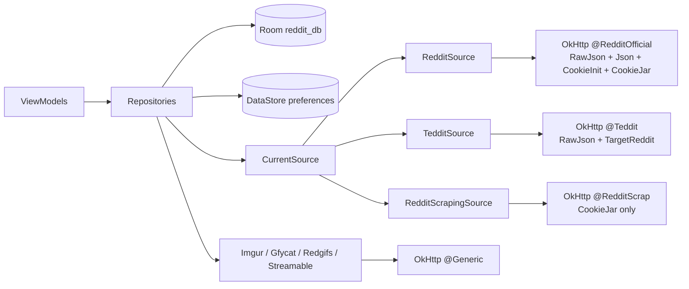

# 04 - Data Layer

This document describes the current data layer at HEAD (`07577e5`), including the **cookie bootstrap hotfix** (`45fc13e`) and the **v.reddit audio download fix** (`dfa795f`). It supersedes the earlier description that called `RedditCookieJar` an "in-memory cookie jar for scraped mode".

---

## Architecture Overview



Repositories are the single source of truth for the UI. Room/DataStore own local state; the `CurrentSource` strategy owns remote state.

---

## 1. Local Persistence

### Room database

`data/local/RedditDatabase.kt`, database name `reddit_db` (`di/DatabaseModule.kt:20`), **schema version 4**, `exportSchema = true`.

| Entity | Table | DAO | Contents |
|---|---|---|---|
| `Subscription` | `subscription` | `SubscriptionDao` | name, time, icon, `profile_id`; PK `(name, profile_id)` |
| `History` | `history` | `HistoryDao` | `post_id`, time, `profile_id`; PK `(post_id, profile_id)` |
| `Profile` | `profile` | `ProfileDao` | id (auto), name |
| `PostEntity` | `post` | `PostDao` | full saved-post snapshot + `profile_id`; PK `(id, profile_id)` |
| `Comment.CommentEntity` | `comment` | `CommentDao` | full saved-comment snapshot + `profile_id`; PK `(name, profile_id)` |
| `Redirect` | `redirect` | `RedirectDao` | `pattern`, `redirect`, `service` (PK), `mode` |

`SubredditEntity` (`data/model/db/SubredditEntity.kt`) is **not** a Room entity; it is a UI mapping target produced by `SubredditMapper2` from `AboutData`.

**Profile isolation.** Every per-profile table carries `profile_id`:

- Composite primary keys include `profile_id`.
- Foreign keys reference `profile(id)` with `ON DELETE CASCADE`.
- DAO queries always filter by `profile_id`, e.g. `SELECT * FROM subscription WHERE profile_id = :profileId`.
- `MIGRATION_2_3` adds indexes on `profile_id` for `history`, `post`, `subscription` and `comment`.

**Default profile.** `RedditDatabase.Callback.onCreate()` runs
`INSERT INTO profile (id, name) VALUES(1, 'Stealth')` (`RedditDatabase.kt:55-60`). Existing installs upgraded from v1 receive the same row in `MIGRATION_1_2`.

**Migrations:**

| Migration | Changes |
|---|---|
| `MIGRATION_1_2` | Creates `profile`; rebuilds `subscription` and `history` with `profile_id`; creates `post` and `comment` tables |
| `MIGRATION_2_3` | Adds `profile_id` indexes |
| `MIGRATION_3_4` | Creates `redirect` (PK `service`) |

Exported schemas live in `app/schemas/com.cosmos.unreddit.data.local.RedditDatabase/`.

### DataStore

One `DataStore<Preferences>` named `preferences` (`di/PreferencesModule.kt`), accessed only through `PreferencesRepository`.

| Key | Type | Default | Read by |
|---|---|---|---|
| `night_mode` | Int | `MODE_NIGHT_FOLLOW_SYSTEM` | `UnredditApplication`, Preferences |
| `left_handed_mode` | Boolean | `false` | `UiViewModel`, `MainActivity` |
| `show_nsfw` | Boolean | `false` | `ContentPreferences`, post filtering |
| `show_nsfw_preview` | Boolean | `false` | Post previews |
| `show_spoiler_preview` | Boolean | `false` | Post previews |
| `reddit_source` | Int | `0` (`REDDIT`) | `CurrentSource`, `RedditSourceDialogFragment` |
| `reddit_source_instance` | String | `""` → `https://teddit.net/` | `TedditApi` provider |
| `privacy_enhancer` | Boolean | `false` | `LinkRedirector` |
| `current_profile` | Int | `1` | `BaseViewModel` |
| `mute_video` | Boolean | `false` | `MediaViewer` |
| `policy_disclaimer_shown` | Boolean | `false` | `MainActivity` |

---

## 2. Remote Layer

### OkHttp client matrix

`di/NetworkModule.kt`. Application interceptors execute in the order listed:

| Qualifier | Interceptors | CookieJar | Retrofit |
|---|---|---|---|
| `@RedditOkHttp` | `RawJsonInterceptor` → `JsonInterceptor` → `RedditPathInterceptor` → `RedditOAuthInterceptor` | — | `RedditApi` at `https://oauth.reddit.com/` |
| `@TedditOkHttp` | `RawJsonInterceptor` → `TargetRedditInterceptor` | — | `TedditApi` |
| `@RedditScrapOkHttp` | — | `RedditCookieJar` | `RedditApi` at `https://old.reddit.com/` |
| `@GenericOkHttp` | — | — | Imgur, Gfycat, Redgifs, Streamable |

All clients use 60 s connect/read/write timeouts.

### Exact JSON request construction

For a call such as `getSubreddit("android", TOP, DAY)`:

1. Retrofit builds `GET /r/android/top?t=day`.
2. `RawJsonInterceptor` adds `raw_json=1` → `/r/android/top?t=day&raw_json=1`.
3. `JsonInterceptor` appends `.json` as a path segment → `/r/android/top/.json?t=day&raw_json=1`.
4. `RedditPathInterceptor` encodes blocked thread routes (`/r/android%2fcomments/...`) and `/api%2fmorechildren`.
5. `RedditOAuthInterceptor` adds `Authorization: Bearer ...` and the Android client headers; a `401` invalidates the token and retries once.
6. Moshi parses the `ResponseBody` manually in `RedditSource` using generated adapters (`ListingJsonAdapter`, `AboutChildJsonAdapter`, …).

For the scraper client, steps 2–3 are skipped: the HTML page at `old.reddit.com` is fetched and parsed by Jsoup.

### App-only OAuth (2026-10-22)

**Solution.** The official client mints an anonymous, app-only token from Reddit's Android OAuth endpoint and calls `oauth.reddit.com`. It still has no user login.

| Component | Behaviour |
|---|---|
| `RedditOAuthManager` (`data/remote/api/reddit/RedditOAuthManager.kt:30-137`) | Persists a random device UUID in `reddit_oauth`; `POST https://www.reddit.com/auth/v2/oauth/access-token/loid` with Basic `base64("ohXpoqrZYub1kg:")`, body `{"scopes":["*","email","pii"]}`, Android UA and `x-reddit-*` headers; caches token, `x-reddit-loid`, `x-reddit-session`, QoS and expiry in memory; refreshes 120 s before expiry |
| `RedditOAuthInterceptor` (`RedditOAuthInterceptor.kt:12-47`) | Adds the bearer token and Android headers to every official request; on `401`, closes, invalidates and retries once |
| `RedditPathInterceptor` (`RedditPathInterceptor.kt:24-41`) | Rewrites `/r/<sub>/comments...` to `/r/<sub>%2fcomments...`; rewrites `/api/morechildren` and `/api/info` to `%2f` forms |
| `RedditApi.BASE_URL` (`RedditApi.kt:113`) | `https://oauth.reddit.com/` |
| `@RedditOkHttp` (`di/NetworkModule.kt:124-139`) | `RawJson` → `Json` → `Path` → `OAuth`; no cookie jar |

The token lasts about 24 hours (`expires_in: 86399` observed). Listings, `about`, user pages and search work directly. Thread pages and more-children need the encoded slash because Reddit returns the HTML block page for the literal `/r/<sub>/comments` and `/api/morechildren` paths when the token is app-only. `/api/morechildren` expects bare comment IDs (`pega7r8`), not `t1_` fullnames; the app already sends bare IDs.

This uses Reddit's private Android client ID and spoofed headers, so it is ToS-sensitive and can be revoked. Full evidence and caveats: [08 §3.1.2](08-Working-Principles-Evolution-and-Fixes.md#312-oauth-workaround--implemented-2026-10-22).

#### Historical: cookie bootstrap (`45fc13e`, removed 2026-10-22)

The following is retained as history; it is no longer wired.

**Problem.** Reddit stopped serving unauthenticated `.json` endpoints. A plain Retrofit request now returns a challenge/error instead of JSON.

**Solution.** The official client pretends to be a browser that has already solved Reddit's JavaScript challenge. It acquires the anonymous `token_v2` cookie and keeps it in an app-wide memory cache backed by Android's system `CookieManager`.

**Files changed:**

| File | Before `45fc13e` | After `45fc13e` |
|---|---|---|
| `data/remote/api/reddit/RedditCookieInitializationInterceptor.kt` | Did not exist | Interceptor that detects and acquires `token_v2` |
| `data/remote/api/reddit/RedditCookieJar.kt` | Returned only hardcoded `over18=1`; `saveFromResponse()` was `// ignore` | App-wide memory cache merged with `CookieManager`; saves every response cookie and calls `flush()` |
| `di/NetworkModule.kt` | `@RedditOkHttp` had no cookie jar | Adds `RedditCookieInitializationInterceptor` and `.cookieJar(RedditCookieJar)` |

**Exact runtime sequence** (`RedditCookieInitializationInterceptor.kt`):

```text
Request through @RedditOkHttp
  │
  ├─ hasRequiredCookies()
  │    RedditCookieJar.hasCookie("token_v2")
  │      memory cache / CookieManager
  │      contains "token_v2" ? ── yes ──► proceed with original request
  │                                  │
  │                                  no
  │                                  ▼
  ├─ GET https://www.reddit.com/                    (plain HTML, no .json)
  │    body = response.body.string()
  │    close response
  │
  ├─ Jsoup.parse(body)
  │    script[nonce] → inner HTML
  │    regex: await(async <param>=>(<operation>))("<baseValue>")
  │    executeOperation:
  │      operation == param + param ? baseValue + baseValue : baseValue
  │    input[name=token] or input[name=jsc_token] → name, value
  │
  ├─ GET https://www.reddit.com/?solution=<solution>
  │       &js_challenge=1&<tokenName>=<tokenValue>&jsc_orig_r=
  │    close response
  │
  ├─ Set-Cookie headers → RedditCookieJar.saveFromResponse()
  │    memoryCookies += cookie
  │    CookieManager.setCookie(url, cookie)
  │    CookieManager.flush()
  │
  └─ proceed with original request
       RedditCookieJar.loadForRequest()
         memoryCookies + CookieManager cookies + over18=1
```

Line references:

| Step | Location |
|---|---|
| Cookie presence check | `RedditCookieInitializationInterceptor.kt:12-14`; `RedditCookieJar.kt:60-69` |
| Intercept decision | `:16-22` |
| HTML GET | `:26-34` |
| `script[nonce]` / token input | `:36-42` |
| Challenge URL | `:43-50` |
| Success/failure logs | `:52-55` |
| Regex extraction | `:59-73` |
| Operation evaluation | `:78-90` |
| Cookie persistence | `RedditCookieJar.kt:47-58` |
| Cookie loading + `over18=1` | `RedditCookieJar.kt:21-45` |

**What this is and is not:**

- It is **not** authentication and not a login. No username/password, OAuth or user token is involved.
- It **is** an anonymous anti-bot cookie acquisition. The app now holds a Reddit-issued `token_v2` for the anonymous session.
- The gate is process-wide because `RedditCookieJar` is an `object` and `CookieManager` is a system service; the two extra requests happen once per install/session, not per API call.
- The memory cache is the immediate source of truth for the current session. It removes the race where `CookieManager.setCookie()` had not completed before the first JSON request read the cookies, which is why older builds needed several launches.

**Concrete failure modes in the historical implementation:**

1. **Challenge-shape dependency.** `executeOperation()` only evaluates the `param + param` form. Any other JS expression returns `baseValue` unchanged, which may produce an invalid `solution`.
2. **Silent failure.** All exceptions are caught and logged (`CookieInterceptor`); the original request still runs and may fail with the original Reddit block/HTTP error.
3. **Scraper client asymmetry.** `@RedditScrapOkHttp` has the cookie jar but **not** the initialization interceptor, so old-Reddit HTML fetching does not bootstrap `token_v2`.
4. **Blocked network thread.** The two bootstrap requests run synchronously inside the OkHttp interceptor, adding latency to the first request.
5. **No refresh.** `RedditCookieJar.hasCookie()` only checks presence (and memory expiry); a revoked/stale `token_v2` is not proactively renewed.
6. **Server-side anonymous JSON block.** Even a valid anonymous `token_v2` is not enough anymore. See below.

**Verification of the historical wiring:**

- At the time, `@RedditOkHttp` ran `RedditCookieInitializationInterceptor` and used `RedditCookieJar`.
- `@RedditScrapOkHttp` still has `RedditCookieJar()` (`di/NetworkModule.kt:168-174`), but no initializer.
- `@TedditOkHttp` has no cookie jar.
- `RedditCookieInitializationInterceptor` was deleted on 2026-10-22.

**October 2026 update — anonymous `.json` is blocked.**

The original `45fc13e` premise (a browser cookie is sufficient) no longer holds. Two separate problems were confirmed on 2026-10-22:

1. The live challenge form renamed its field to `jsc_token`; the old code read `input[name=token]` and sent `token=`, so no valid `token_v2` was issued. The interim interceptor was patched to accept either name; it was later removed in favour of OAuth.
2. After the fixed challenge issues `token_v2` (plus `loid`, `session_tracker`, `csrf_token`, `csv`, `edgebucket`), `https://www.reddit.com/r/popular/hot/.json` still returns `403 text/html` with *"blocked due to a network policy"*. The same session gets `200` from `https://www.reddit.com/r/popular/hot.rss`, and `old.reddit.com` redirects to `/login/?reason=lor2`. Reddit now requires a login session or developer credentials for JSON.

Consequences:

- The official `REDDIT` source cannot be restored anonymously by any `CookieJar` change.
- The `REDDIT_SCRAP` source is also affected because `old.reddit.com` redirects to the login page.
- RSS still returns data but only listings (no comments/search/scores); Reddit has announced that anonymous RSS support ends on **2026-11-13**.
- Anonymous JSON access needed a product decision. The chosen implementation is the app-only OAuth flow above; optional login, user-supplied cookies and an RSS-only fallback remain unimplemented.

### Source strategy

Three implementations of `BaseRedditSource`, selected by `CurrentSource`:

| Enum (`reddit_source`) | Implementation | Transport | Base URL |
|---|---|---|---|
| `REDDIT` (0) | `RedditSource` | Retrofit + Moshi JSON | `https://www.reddit.com/` |
| `TEDDIT` (1) | `TedditSource` | Retrofit (`?api`) | configured instance, default `https://teddit.net/` |
| `REDDIT_SCRAP` (2) | `RedditScrapingSource` | Retrofit HTML + Jsoup | `https://old.reddit.com/` |

**Capability matrix** (`CurrentSource` routing):

| Method | Active source | Fallback |
|---|---|---|
| `getSubreddit`, `getSubredditInfo`, `searchInSubreddit` | selected | — |
| `getPost` | selected | — |
| `getUserInfo`, `getUserPosts`, `getUserComments` | selected | — |
| `searchSubreddit` | selected | — |
| `getMoreChildren` | **always `RedditSource`** (`CurrentSource.kt:59-62`) | — |
| `searchPost` | **always `RedditSource`** (`:86-94`) | — |
| `searchUser` | **always `RedditSource`** (`:96-104`) | — |

Known stubs:

- `TedditSource.getMoreChildren/searchPost/searchUser` throw `UnsupportedOperationException` (`TedditSource.kt:43,74,83`), but `CurrentSource` never routes those methods to it.
- `RedditScrapingSource.searchInSubreddit` returns an empty `Listing` (`:58-60`).
- `RedditScrapingSource.getMoreChildren` returns an empty `MoreChildren` (`:78-80`).
- `RedditScrapingSource.searchPost/searchUser` return empty listings (`:113-124`), but `CurrentSource` routes them to `RedditSource`.

`CurrentSource` construction reads the preference with `runBlocking { ... .first() }` (`:27-30`); `setRedditSource(value)` swaps the delegate under a `Mutex` (`:115-119`).

### Scrapers

`data/remote/scraper/Scraper.kt` is the abstract Jsoup base. Concrete scrapers in `data/remote/api/reddit/scraper/`:

| Scraper | Parses |
|---|---|
| `RedditScraper` | Base selectors/timeouts |
| `PostScraper` | Post listings and post headers |
| `CommentScraper` | Comment trees |
| `SubredditScraper` | Subreddit about/sidebar |
| `SubredditSearchScraper` | Subreddit search results |
| `UserScaper` | User profile pages |
| `Over18Scraper` | NSFW confirmation page (defined, not referenced elsewhere) |

`RedditScrapingSource.getSubredditInfo()` calls `getSubreddit(subreddit, HOT, null)` and scrapes it with `SubredditScraper` (`RedditScrapingSource.kt:46-49`); `getUserInfo()` calls `getUserPosts(user, HOT, null)` and scrapes with `UserScaper` (`:82-85`).

### Third-party media APIs

| API | Endpoint | Repository |
|---|---|---|
| Imgur | `https://api.imgur.com/` (album/image) | `ImgurRepository.getAlbum(albumId)` |
| Gfycat | `https://api.gfycat.com/` | `GfycatRepository.getGfycatGif(id)` |
| Redgifs | `https://api.redgifs.com/` — `GET /v2/auth/temporary`, then `GET /v2/gifs/{id}` with `Bearer` token | `RedgifsRepository.getRedgifsGif(id)` |
| Streamable | `https://api.streamable.com/` | `StreamableRepository.getVideo(shortcode)` |

`RedgifsToken` caches the temporary bearer token for the process lifetime and does not retry after expiry (`data/remote/api/redgifs/RedgifsToken.kt`).

### Interceptor summary

| Interceptor | Location | Exact effect |
|---|---|---|
| `RawJsonInterceptor` | `data/remote/RawJsonInterceptor.kt` | Adds `raw_json=1` query parameter |
| `JsonInterceptor` | `data/remote/api/reddit/JsonInterceptor.kt` | Adds `.json` path segment |
| `TargetRedditInterceptor` | `data/remote/TargetRedditInterceptor.kt` | Adds `target=reddit` query parameter |
| `RedditPathInterceptor` | `data/remote/api/reddit/RedditPathInterceptor.kt` | Encodes the blocked `/comments` and `/api/morechildren` routes |
| `RedditOAuthInterceptor` | `data/remote/api/reddit/RedditOAuthInterceptor.kt` | Adds the app-only bearer token and Android client headers; retries once on `401` |
| `RedditCookieJar` | `data/remote/api/reddit/RedditCookieJar.kt` | Scraper only: merges `CookieManager` cookies and forces `over18=1` |

---

## 3. Paging Data Sources

All sources implement Paging 3 `PagingSource` and call `CurrentSource`.

| DataSource | Key behavior |
|---|---|
| `SmartPostListDataSource` | Wraps a **list** of subreddits. ≤100 → one `a+b+c` request. >100 → chunk size `ceil(n / ceil(n/100))`, parallel requests, per-chunk `after` keys, merge by NEW (created desc), TOP (score desc), otherwise interlace. Page size is 25 from `PostListRepository`. |
| `PostListDataSource` | Single-post-list paging |
| `UserPostsDataSource` | `/user/{user}/submitted` |
| `CommentsDataSource` | `/user/{user}/comments` |
| `SearchPostDataSource` | Global post search |
| `SearchUserDataSource` | User search |
| `SearchSubredditDataSource` | Subreddit search |
| `SubredditSearchPostDataSource` | `/r/{sub}/search?restrict_sr=1` |

Error handling in `SmartPostListDataSource.load()` catches `IOException`, `HttpException` and `JsonDataException` and returns `LoadResult.Error` (`:41-51`).

---

## 4. Repositories

| Repository | Responsibilities |
|---|---|
| `PostListRepository` | `Pager` creation, post details, more-children, subscriptions, history, profiles, saved posts/comments, searches. Page size `DEFAULT_LIMIT = 25`. |
| `PreferencesRepository` | Typed read/write for all DataStore keys; exposes combined preference flows |
| `BackupRepository` | Export/import through `BackupManager` implementations |
| `ImgurRepository` | Album fetch |
| `GfycatRepository` | Video metadata |
| `RedgifsRepository` | Bearer token + GIF metadata |
| `StreamableRepository` | Video metadata |
| `AssetsRepository` | Bundled asset text |

Saved items are full snapshots: `savePost()` maps a `PostEntity` (including media type/URL, gallery, awards, flair, etc.) into the `post` table with the active `profile_id`; `saveComment()` does the same for `CommentEntity`.

---

## 5. Media Downloads (`dfa795f`)

`data/worker/MediaDownloadWorker.kt` is a `@HiltWorker` CoroutineWorker.

1. Input: `KEY_URL`, `KEY_TYPE` (`GalleryMedia.Type.value`), `KEY_SOUND` (optional audio URL).
2. Shows a notification on channel `<applicationId>.DOWNLOAD_MANAGER_CHANNEL`, notification ID `856`.
3. Writes to MediaStore (API >= 29) with `IS_PENDING=1`, or to public Pictures/Movies with `MediaScannerConnection` (API < 29).
4. If `sound != null`, downloads the audio separately:
   - Video name: `<file>_video.<ext>` (`:88`).
   - Audio name: `<file>_audio` (`:101`).
5. On API >= 29, `muxAudioVideo()` (`:408-495`) muxes:
   - Creates `video/mp4` MediaStore entry.
   - `MediaExtractor` selects the first `video/*` and first `audio/*` track.
   - `MediaMuxer` with `MUXER_OUTPUT_MPEG_4`.
   - Clears `IS_PENDING`, deletes the two temporary entries.
6. On API < 29, the mux is skipped (`muxAudioVideo` is guarded by `Build.VERSION_CODES.Q`), `mergedUri` is `null`, and the worker reports `Result.failure()` even though both files were written. This is a concrete current limitation.
7. Work is unique per URL: `enqueueUniqueWork(url, APPEND_OR_REPLACE, request)` with tag `MediaDownloadWorker` (`:390-404`). `cancelWork()` cancels **all** work with that tag.

`DownloadManagerReceiver` (`data/receiver/DownloadManagerReceiver.kt`):

- `ACTION_DOWNLOAD_RETRY` reads `KEY_URL`, `KEY_TYPE`, `KEY_SOUND` and re-enqueues.
- `ACTION_DOWNLOAD_CANCEL` cancels all tagged downloads.
- Registered non-exported for `<applicationId>.ACTION_DOWNLOAD_RETRY` / `.ACTION_DOWNLOAD_CANCEL` in `AndroidManifest.xml`.

---

## 6. Privacy Enhancer redirects

- Stored in Room `redirect` (`service` PK) with `pattern` (regex), target `redirect` host, and mode.
- Modes: `ON(0)`, `OFF(1)`, `ALWAYS_ASK(2)` (`data/model/db/Redirect.kt`).
- `LinkRedirector` loads `privacy_enhancer` and all redirects at construction with `runBlocking`, compiles patterns to `Regex`, and keeps `Map<Regex, Redirect>` (`util/LinkRedirector.kt:25-32`).
- Matching is by **host only** (`:36-40`); redirecting rewrites the host and preserves scheme/path/query (`:55-57`).
- Applied only to non-media links in `LinkHandler.openLink()` (`util/LinkHandler.kt:70-79`).

---

## 7. Caching and State Ownership

| State | Owner |
|---|---|
| Feed pages | `PagingSource` (no `RemoteMediator`); cached in memory by `cachedIn(viewModelScope)` |
| Subscription list | Room `subscription`, observed as `Flow<List<Subscription>>` |
| History | Room `history`, observed as `Flow<List<String>>` |
| Saved posts/comments | Room `post` / `comment`, full snapshots |
| Settings | DataStore `preferences` |
| Active profile | DataStore `current_profile` |
| Reddit cookies | `RedditCookieJar` memory cache + Android `CookieManager` (persisted) |
| Video cache | ExoPlayer `SimpleCache`, 100 MB LRU in `cacheDir` |
| Image cache | Coil memory/disk (read-only during media viewing) |
| Redirect rules | Room `redirect`, mirrored in `LinkRedirector` |

There is no `RemoteMediator`; remote pages are not persisted. Only explicit actions (history insert, save, subscribe) write to Room.

---

## 8. Data-Layer Caveats

- `SubredditEntity` is not persisted.
- `RedditApi.consentOver18()` and `Over18Scraper` exist but are unreferenced.
- `RedditCookieJar`'s class-level `cookies` field is dead code after the hotfix.
- Teddit and scraped sources are not feature-complete; three operations are hard-wired to the official source.
- `RedgifsToken` never refreshes an expired token.
- The download merge is unavailable below API 29.
- Room, DataStore and network layers have no automated tests (see [07-Testing.md](07-Testing.md)).
